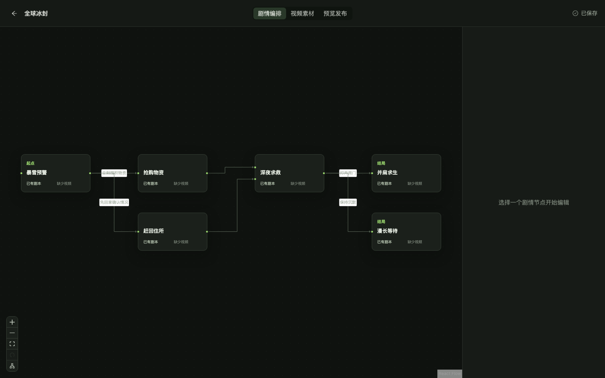
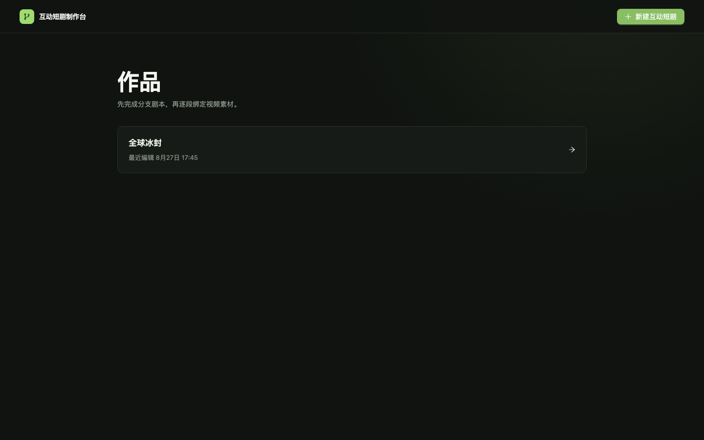
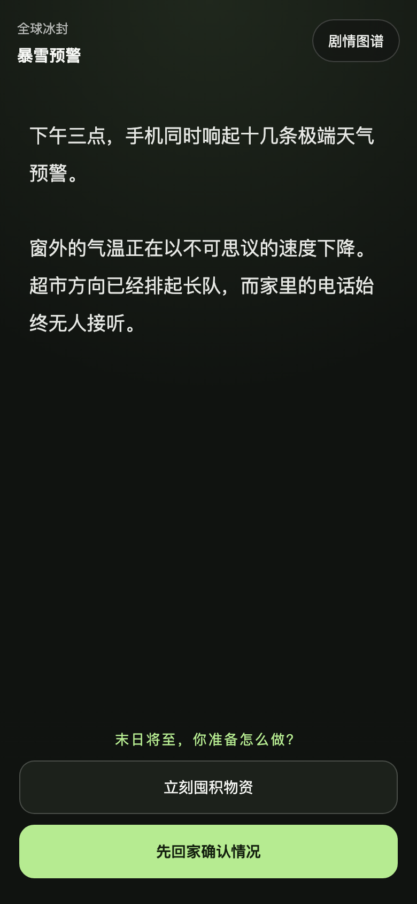

# AI 互动短剧制作与播放平台

[](LICENSE)

一个可本地部署的互动短剧 Demo，包含可视化制作平台和移动端 H5 播放器。制作人员可以创建作品、编排分支剧情、录入剧本、上传视频、预览并发布版本；观众通过发布链接体验视频或纯文本剧情。



<table>
  <tr>
    <td width="66%"></td>
    <td width="34%"></td>
  </tr>
  <tr>
    <td align="center">制作平台</td>
    <td align="center">H5 播放端</td>
  </tr>
</table>

## 功能

- 可视化剧情节点与分支编排
- 节点剧本录入及 TXT、Markdown、DOCX 导入
- MP4 视频素材上传和节点绑定
- 草稿预览、发布检查、版本历史与回滚
- 支持固定版本链接的移动端 H5 播放器
- 无视频节点以可滚动的纯文本剧本展示
- 本地文件持久化，不依赖数据库或云存储

## Docker Compose 一键部署

需要 Docker 及 Docker Compose。执行：

```bash
docker compose up --build -d
```

启动后访问：

- 制作平台：<http://127.0.0.1:6001/studio>
- H5 播放端：发布作品后，从制作平台的发布记录复制链接
- 健康检查：<http://127.0.0.1:6001/healthz>

作品、剧本、版本和视频保存在 Docker 卷 `interactive-drama-data` 中，重新构建或重启容器不会丢失。停止服务使用：

```bash
docker compose down
```

如需同时删除本地业务数据，明确确认后再执行 `docker compose down -v`。

默认仅监听本机回环地址。如需在局域网内访问，可将 `compose.yaml` 中的端口映射改为 `6001:6001`。当前版本没有用户登录和权限系统，请勿直接暴露到公网。

## 源码启动

需要 Node.js 22、pnpm 10 和现代浏览器。

```bash
pnpm install
pnpm dev
```

- 开发制作平台：<http://127.0.0.1:5173/studio>
- API：<http://127.0.0.1:6001>
- 本地数据目录：项目根目录 `.data/`

构建并以单进程方式运行制作平台、H5 和 API：

```bash
pnpm build
NODE_ENV=production pnpm start
```

`pnpm start` 会自动读取项目根目录中可选的 `.env` 文件。开发模式需要先把变量载入当前终端，或直接在命令前传入。

## 环境变量

复制 `.env.example` 为 `.env` 后按需修改：

| 变量 | 默认值 | 用途 |
| --- | --- | --- |
| `HOST` | `127.0.0.1` | 服务监听地址；Docker 容器内覆盖为 `0.0.0.0` |
| `PORT` | `6001` | 服务监听端口 |
| `MAX_UPLOAD_BYTES` | `524288000` | 单个视频上传上限 |
| `STORAGE_DRIVER` | `local` | 本地部署版固定为 `local` |
| `LOCAL_STORAGE_ROOT` | `.data` | 作品、素材和版本存储目录 |
| `LOCAL_PUBLIC_BASE_URL` | `/media` | 本地素材访问路径 |

## 素材约束

- 视频：MP4，推荐 H.264 视频轨和 AAC 音轨；平台不负责转码。
- 剧本：可直接输入、粘贴，或导入 TXT、Markdown、DOCX。
- 剧情：允许多分支汇合，不允许循环；草稿可不完整，发布前会检查起点、断链、可达性和循环。

## 开发验证

```bash
pnpm typecheck
pnpm test
pnpm build
pnpm e2e
```

## 项目结构

```text
apps/studio/      React 制作平台与 H5 播放器
apps/server/      Fastify API、静态资源和本地文件存储
packages/domain/  剧情数据结构、校验与发布清单
skills/           互动剧本自动导入 Skill
tests/            端到端测试
```

## 数据备份

- 源码运行：停止服务后完整备份 `.data/`。
- Docker Compose：停止服务后备份 Docker 卷 `interactive-drama-data`。

恢复时将完整数据目录或数据卷还原后重新启动服务。

## 安全说明

这是面向本地和可信局域网的轻量制作工具，当前不包含用户登录、权限隔离和审计系统。不要将制作端直接暴露到公网。发现安全问题请参阅 [SECURITY.md](SECURITY.md)。

## 参与贡献

欢迎提交 Issue 和 Pull Request。开始开发前请阅读 [CONTRIBUTING.md](CONTRIBUTING.md)。

## License

本项目基于 [Apache License 2.0](LICENSE) 开源。
